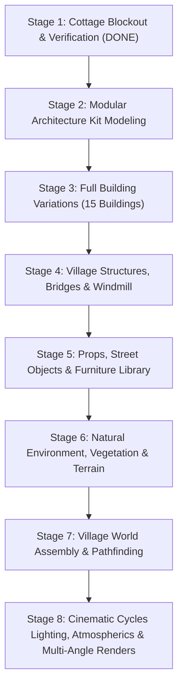

# Realistic Medieval Fantasy Village — Master Modeling & Production Plan

**Project:** Realistic Medieval Fantasy Village  
**Engine & Tooling:** Blender 5.2.3 LTS | Python API (`bpy`, `bmesh`, `mathutils`) | Cycles GPU (OptiX)  
**Target Platform:** Windows PC (16 GB RAM, mid-range NVIDIA RTX GPU)  
**Visual Style:** High-fidelity European medieval vernacular realism (timber-framed *Fachwerk*, rubble masonry, weathered slate/clay tiles, organic cobblestone ground).

---

## 1. Architectural Guidelines & Proportions

### Metric Units & Architectural Scale
- **Grid Module:** 1.0 m base grid with 2.0 m and 4.0 m modular architectural snap increments.
- **Story Heights:**
  - Undercroft / Ground floor stone masonry: **2.60 m – 2.80 m** clear height.
  - Intermediate timber floor frame & jetty projection: **0.25 m – 0.35 m** cantilever overhang.
  - Upper floor timber-framed walls: **2.30 m – 2.50 m** height.
  - Roof pitch: **48° to 55°** steep European pitch for authentic drainage and attic lofts.
- **Structural Integrity:**
  - Posts, girts, and tie beams: Minimum 0.18 m × 0.18 m to 0.24 m × 0.24 m heavy squared oak timber.
  - Foundation plinths: 0.40 m – 0.50 m thick rubble masonry with dressed corner quoins and water-table drip chamfers.
  - Roof eave overhang: 0.40 m – 0.60 m to protect lime plaster walls from rainwater erosion.

---

## 2. Comprehensive 85+ Asset Library Breakdown

The asset library is systematically cataloged across 6 core production collections:

```
Medieval_Village_Asset_Library
├── 01_BUILDINGS (15 Types)
├── 02_MODULAR_ARCHITECTURE (15 Modular Kits)
├── 03_VILLAGE_STRUCTURES (10 Structures)
├── 04_FURNITURE_PROPS (15 Items)
├── 05_STREET_OBJECTS (10 Objects)
└── 06_ENVIRONMENT_NATURE (15 Flora & Landscape Elements)
```

### Category 1: Buildings (15 Types)
| ID | Asset Name | Dimensions (W x D x H) | Architectural Features |
|---|---|---|---|
| B01 | **Main Timber & Stone Cottage** | 6.8m × 8.4m × 8.25m | Cantilevered jetty, massive gable chimney, arched plank door, porch canopy |
| B02 | **Village Tavern ("The Prancing Boar")** | 12.0m × 16.0m × 10.5m | 2-story L-shape, outdoor covered porch, twin hearths, wine cellar entry |
| B03 | **Pilgrim's Inn & Guesthouse** | 9.0m × 14.0m × 9.8m | Multiple dormer windows, exterior wooden gallery staircase |
| B04 | **St. Jude's Medieval Church** | 14.0m × 24.0m × 18.0m | Ashlar stone nave, gothic pointed arches, buttresses, rose window framing |
| B05 | **Bell Tower (Detached/Attached)** | 5.5m × 5.5m × 22.0m | 4-tier stone masonry, arched belfry, copper/shingle spire |
| B06 | **Village Blacksmith & Forge** | 8.5m × 10.0m × 6.8m | Open covered hearth shed, stone furnace, water trough, charcoal storage |
| B07 | **Threshed Thatched Barn** | 10.0m × 18.0m × 8.5m | High timber cruck frames, double wagon barn doors, hayloft hatch |
| B08 | **Timber Horse Stables** | 7.0m × 14.0m × 5.5m | 4 individual horse stalls, paddock fence, feed troughs, tack room |
| B09 | **Lord's Manor House** | 14.0m × 20.0m × 12.5m | Reinforced stone lower keep, mullioned bay windows, slate hip roof |
| B10 | **Miller's River Cottage** | 6.0m × 7.5m × 7.8m | Overhanging balcony above river flume, heavy stone sub-structure |
| B11 | **Baker's Shop & Stone Oven** | 7.0m × 8.0m × 7.5m | Protruding dome stone bread oven, street service counter window |
| B12 | **Carpenter / Cooper Workshop** | 7.5m × 9.0m × 6.8m | Open timber-framed side lean-to, timber drying racks |
| B13 | **Fisherman's River Shanty** | 5.0m × 6.5m × 6.0m | Raised stilts along riverbank, boat tie-up cleats, net drying rack |
| B14 | **Apothecary & Herb House** | 5.8m × 7.0m × 8.0m | Narrow 3-story medieval townhouse, attic drying rack, bay window |
| B15 | **Guard Garrison / Gatehouse** | 9.0m × 11.0m × 11.0m | Machicolations, iron portcullis gate, arrow slits, watch platform |

### Category 2: Modular Architecture Components (15 Kits)
| ID | Asset Name | Function / Placement |
|---|---|---|
| A01 | **Mod_Stone_Wall_Straight_4m** | 4.0m × 0.45m × 2.8m ground floor stone wall with dressed quoins |
| A02 | **Mod_Stone_Wall_Window_4m** | 4.0m wall with centered dressed stone arched window aperture |
| A03 | **Mod_Stone_Wall_Door_4m** | 4.0m wall with round-arched entry doorway opening |
| A04 | **Mod_Timber_Wall_Plaster_4m** | 4.0m × 2.4m half-timber wall with diagonal cross bracing |
| A05 | **Mod_Timber_Wall_DoubleWin_4m** | 4.0m wall with twin leaded casement windows and operable shutters |
| A06 | **Mod_Roof_Slope_Tile_4x4m** | 50° pitch modular clay-tile roof section with eave gutter bracket |
| A07 | **Mod_Roof_Gable_End_Tri_4m** | Triangular plaster and timber gable with king post truss |
| A08 | **Mod_Roof_Ridge_Cap_4m** | Interlocking terracotta half-round ridge tile capping |
| A09 | **Mod_Roof_Dormer_Window** | Pitched roof dormer window unit with timber apron |
| A10 | **Mod_Jetty_Floor_Section_4m** | Cantilever joist section with carved corbel brackets |
| A11 | **Mod_Door_Arched_Plank** | Heavy oak vertical plank door with forged iron strap hinges |
| A12 | **Mod_Window_Mullion_Stone** | 2-light dressed limestone mullioned window with leaded lattice |
| A13 | **Mod_Window_Timber_Casement** | Dual wooden casement window with wrought iron fasteners |
| A14 | **Mod_Staircase_Stone_Straight** | 1.2m wide stepped stone stairs with beveled nosings |
| A15 | **Mod_Chimney_Modular_Stack** | Stackable 2.0m stone chimney section with corner chamfers |

### Category 3: Village Structures (10 Types)
| ID | Asset Name | Function / Description |
|---|---|---|
| S01 | **Arch_Stone_River_Bridge** | 2-arch heavy stone bridge spanning 14m across the village river |
| S02 | **Four-Sail Wooden Windmill** | Rotating wooden cap windmill with lattice sails and gear housing |
| S03 | **Village Central Water Well** | Hexagonal dressed stone well with wooden roof canopy, pulley & bucket |
| S04 | **Castle Hill Watchtower** | 3-tier round fortified stone tower with crenellated parapet |
| S05 | **Castle Wall Ruins** | Crumbling stone curtain wall section with exposed rubble core |
| S06 | **Palisade Village Gate** | Heavy spiked timber log fortification gate with walkway |
| S07 | **River Waterwheel & Flume** | 4.2m diameter timber paddle wheel with elevated wooden sluice |
| S08 | **Market Stall (Fabric Canopy)** | Timber display trestle with pitched striped canvas canopy |
| S09 | **Livestock Enclosure Pen** | Split-rail timber fencing with gate latch for livestock |
| S10 | **Public Stocks & Pillory** | Elevated wooden platform with hinged neck and wrist timbers |

### Category 4: Furniture & Interior Props (15 Types)
| ID | Asset Name | Function / Description |
|---|---|---|
| P01 | **Trestle_Dining_Table** | Heavy split-oak table top with chamfered trestle legs and wedges |
| P02 | **Tavern_Bench_Long** | 2.2m rough-sawn pine bench with mortise and tenon joints |
| P03 | **Tavern_Stool_ThreeLeg** | Rustic splayed 3-legged wooden stool |
| P04 | **Medieval_Bed_FourPoster** | Timber bed frame with turned posts and straw/cloth bedding |
| P05 | **Wooden_Storage_Chest** | Iron-banded wooden chest with curved hasp and padlock |
| P06 | **Aged_Oak_Barrel_Large** | 120L wooden barrel with 4 forged dark iron hoops |
| P07 | **Aged_Oak_Barrel_Small** | 40L keg with wooden dispensing spigot |
| P08 | **Wooden_Shipping_Crate** | Slatted wood packing crate with reinforcement battens |
| P09 | **Grain_Sack_Burlap** | Bulging woven hessian sack tied with hemp cord |
| P10 | **Woven_Wicker_Basket** | Hand-woven willow basket with curved carrying handle |
| P11 | **Cast_Iron_Cooking_Pot** | 3-legged cauldron with curved iron bail handle |
| P12 | **Fireplace_Hanging_Crane** | Wrought iron adjustable chimney pot hanger |
| P13 | **Pottery_Storage_Jug** | Salt-glazed stoneware jug with curved loop handle |
| P14 | **Kitchen_Wall_Shelf** | Rustic timber shelf with carved brackets and hanging mugs |
| P15 | **Fireplace_Hearth_Grate** | Forged iron log cradle with glowing ember bed |

### Category 5: Street Objects & Infrastructure (10 Types)
| ID | Asset Name | Function / Description |
|---|---|---|
| O01 | **Hanging_Iron_Street_Lantern** | 4-sided glazed iron cage lantern on ornate forged wall bracket |
| O02 | **Tavern_Swinging_Signboard** | Carved timber signboard suspended from wrought iron bracket |
| O03 | **Two-Wheel_Wooden_Handcart** | Spoked wooden wheels, axle, and tilt handles |
| O04 | **Four-Wheel_Farm_Wagon** | Heavy timber transport cart with slatted sideboards |
| O05 | **Post-and-Rail_Wood_Fence** | Weathered split-rail rustic farm perimeter fencing |
| O06 | **Wattle_Hurdle_Fence** | Woven hazel branches fence panel (traditional medieval barrier) |
| O07 | **Carved_Hitch_Post** | Chamfered wooden hitching post with forged iron tether ring |
| O08 | **Directional_Signpost** | Timber post with notched directional pointing arms |
| O09 | **Firewood_Cord_Stack** | Neatly stacked split firewood logs with bark edges |
| O10 | **Street_Water_Trough** | Chiseled hollowed stone water trough for pack horses |

### Category 6: Environment, Flora & Landscape (15 Types)
| ID | Asset Name | Function / Description |
|---|---|---|
| E01 | **Ancient_Oak_Tree** | Gnarled heavy trunk, spreading root flare, dense foliage canopy |
| E02 | **Silver_Birch_Tree** | Slender white/dark bark trunk with drooping branches |
| E03 | **Forest_Pine_Tree** | Tall straight conifer with tiered evergreen branches |
| E04 | **Wild_Blackberry_Bush** | Dense tangled thorny shrub cluster |
| E05 | **Forest_Undergrowth_Fern** | Multi-frond bracken fern cluster |
| E06 | **Field_Grass_Clump_LOD0** | Multi-blade wild fescue grass patch |
| E07 | **Wildflower_Patch** | Red poppies and chamomile wild blooms |
| E08 | **Riverbank_Reeds_Cattails** | Vertical river reed stalks with brown cattail spikes |
| E09 | **Mossy_Granite_Boulder** | Large weathered boulder with top-surface procedural moss |
| E10 | **Riverbed_Pebbles_Cluster** | Smooth water-worn river stones scatter |
| E11 | **Decaying_Fallen_Log** | Hollowed rotting tree trunk with shelf fungus |
| E12 | **Wild_Forest_Mushrooms** | Cluster of agaric / chanterelle forest fungi |
| E13 | **River_Water_Mesh_Curved** | Flowing river mesh with normal wave displacement |
| E14 | **Cobblestone_Path_Module** | Curved and straight worn cobblestone street strips |
| E15 | **Farmed_Vegetable_Furrows** | Tilled earth mounds with cabbage/turnip crops |

---

## 3. Production Milestones & Execution Roadmap



### Stage 1 (Current Milestone):
- Project directory setup.
- Scene units, color management (AgX), Cycles OptiX GPU engine configuration.
- Main timber and stone cottage blockout matching exact metric specifications (6.8m × 8.4m × 8.25m).
- Multi-angle rendering and visual verification.
- User inspection and review.

### Stage 2: Detailed Cottage Detailing & Modular Kit
- Bevel and seam detailing on all stone blocks.
- Real 3D timber peg joints and weathered wood grain displacement.
- Leaded diamond lattice glass windows and operable hardware.
- High-resolution procedural PBR shader graphs.

### Stage 3: Village Structures & Buildings
- Batch procedural generation of remaining 14 buildings using the verified modular components.
- River bridge, castle ruins, well, and windmill construction.

### Stage 4: Props, Furniture & Street Set-Dressing
- Barrels, wagons, market stalls, forge anvils, interior tavern furnishings.

### Stage 5: Environment, Terrain & World Assembly
- Sculpted landscape with elevation hills, river trench, cobblestone road network.
- Instanced vegetation scattering (trees, bushes, grass clumps, boulders).

### Stage 6: Lighting Variations & Cinematic Renders
- Daylight (warm morning/afternoon sun).
- Golden Hour Sunset (rich orange sidelight, long shadows).
- Atmospheric Night scene (warm lantern emissions, moonlight, volumetric mist).

---

## 4. Hardware Optimization & Memory Budget (16 GB RAM / RTX 3050)
- **Geometry Instancing:** Repeated architectural elements (roof tiles, corbels, window frames, barrels, fence rails) use Blender linked duplicates (`object.data` sharing) and Geometry Node collection instances.
- **Modifier Stack Hygiene:** Non-destructive Bevel modifiers restricted to 2 segments with angle limit (35°) and Weighted Normal.
- **Cycles Memory Management:**
  - GPU OptiX acceleration with spatial denoising.
  - Render tile size auto-managed by Blender 5.x.
  - Peak VRAM footprint targeted under 4.5 GB (well within 6 GB VRAM budget).

